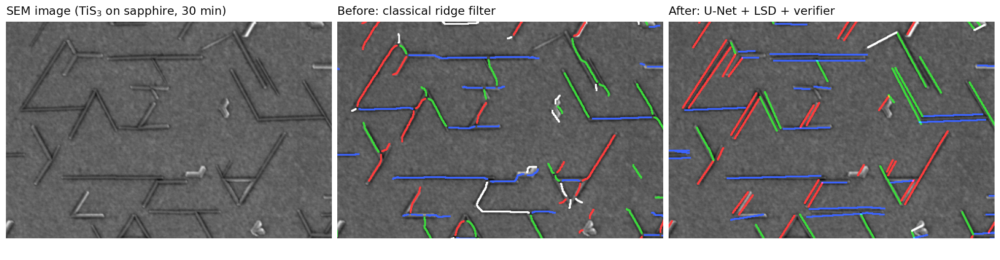
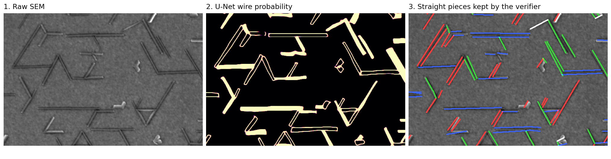
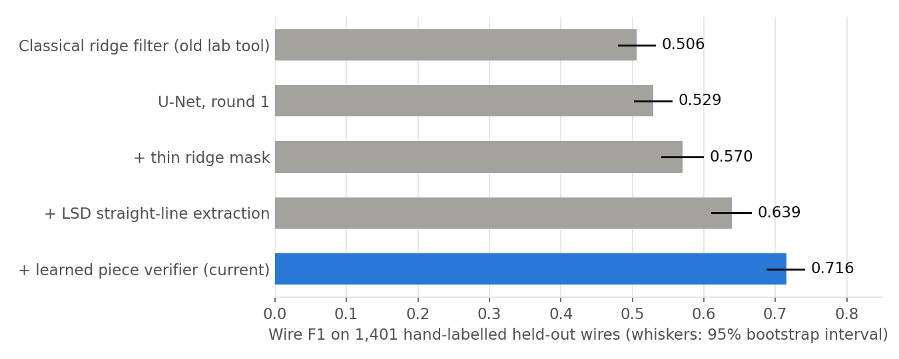
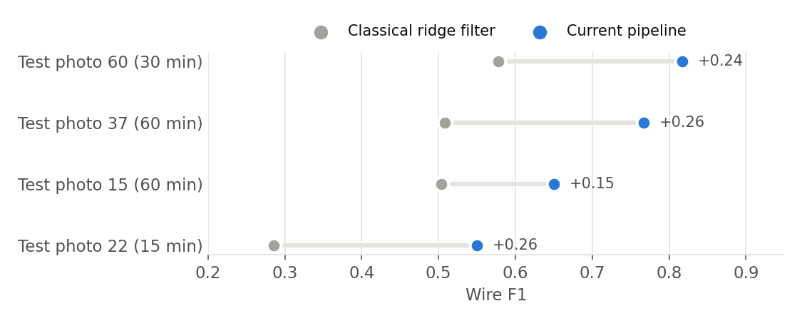
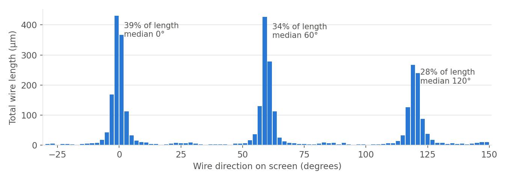

# Counting nanowires so people don't have to

TiS3 nanowires grown on sapphire look like scattered pencil strokes under a scanning electron microscope: hundreds per image, each a few hundred nanometres long, crossing, touching end to end and folding into zig-zags. Materials scientists want simple numbers from these images: how many wires, how long, which way they point and how those numbers change with growth time. Getting them by hand takes hours per photo.

This project turns one SEM image into a table of wires in under a second per photo, and it measurably beats the classical image filter the lab used before.

*A 30-minute growth photo that was not used for training. Colours show the three growth directions (blue 0°, green 60°, red 123.5°, white other). The old filter follows wires around corners and merges zig-zags into single curved wires. The new pipeline returns straight pieces, one per wire.*

---

## The short version

| | Old lab tool (classical ridge filter) | This pipeline |
|---|---|---|
| Wire F1 on 1,401 hand-labelled held-out wires | 0.506 | **0.716** |
| Error in wire count (pooled) | +25% | **+2%** |
| Error in median wire length | -40% | **-15%** |
| Test photos where it wins | | **4 of 4** |

---

## How it works

1. **U-Net segmentation.** A small convolutional network marks the pixels that belong to a wire. It was trained on the old filter's output, cleaned up by hand-corrected quarters of training photos and copy-paste augmentation.
2. **Thin ridge mask.** The network's output is thinned to a narrow ridge so that neighbouring parallel wires stay separate.
3. **Straight-line extraction.** OpenCV's line segment detector (LSD) breaks the mask into straight pieces. Real nanowires are straight, so a corner almost always means two wires touching, not one wire bending.
4. **Learned verifier.** A gradient-boosted classifier looks at each candidate piece (40 features: geometry, network confidence along and beside the line, image contrast, angle to the growth directions, contacts with other pieces) and throws away the ones that look like etch pits, particle edges or duplicate flanks.

The kept pieces are joined across image tiles and measured for length, width, direction and junctions.

---

## Results

Each step was chosen on a separate development set and then scored once on a frozen test set. Every stage added accuracy, and the biggest gains came after the network, in how the mask is turned into wires.

The gain is not driven by one easy photo. It holds on every test photo, across all three growth times:

A finding along the way: when we fed the old extraction step a *perfect* hand-drawn mask, it scored only 0.81. Most errors were never segmentation errors. They came from wires that touch end to end in a V or zig-zag, which the skeleton-based extractor merged into one bent wire. Replacing it with straight-line extraction fixed most of that.

---

## What the measurements show

Run across the 48 photos from the TiS3 growth series in the 50,000-80,000x range (11,361 wires), the wire directions fall into three sharp families, 60° apart:

That is the signature of growth locked to the sapphire crystal lattice. Between the peaks there is almost nothing, which is also a quick sanity check on the extraction. The verifier does use angle to the growth directions as one of its features, so the sharpness of the peaks partly reflects that choice. Also, note that 41 of these 48 photos were also training photos for the network, so this plot illustrates the tool's output rather than serving as an independent test.

---

## How the numbers were kept honest

- **Frozen test set.** Four photos (16 image quarters, 1,401 wires) were labelled by hand and frozen with checksums ([`03_Code/labelling/frozen_test_labels_2026-11-18`](03_Code/labelling/frozen_test_labels_2026-11-18)). They are never edited and never used for training.
- **Choices made on development data.** Every setting (mask thinning, LSD minimum length, verifier threshold) was chosen by cross-validation on hand-corrected training quarters, with leakage-free fold models.
- **Declared, one-shot scoring.** Each test run was declared in advance, run once and hash-stamped. The scorers refuse to run a second time.
- **Stated caveats.** The test set has now been used to score 11 pipelines, and the verifier idea came from studying test errors. Four photos from three growth runs is a small sample, so "better on every test photo" is a fairer claim than a tight confidence interval. Any further round needs a fresh test photo.

## What is still hard

- **Sparse 15-minute growth.** Short growth leaves few wires and a lot of surface clutter. Test photo 22 scores 0.55, and the network still marks some etch pits and particle edges as wires.
- **Dark rods** are sometimes missed.
- **Widths** come from the old filter's mask. Intensity-profile widths would be more reliable.

---

## What's in this repository

| Folder | Contents |
|---|---|
| `01_Docs/` | Project record, segmentation review and roadmap, ridge-filtering handover guide |
| `03_Code/labelling/` | Napari labelling tool (`label_wires.py`), label checker, training-photo correction tool, all hand labels and the frozen test labels |
| `03_Code/starter_code/` | Early baselines (ridge filter, Hough), label conversion, metrics and an oriented-bounding-box dataset export |
| `assets/` | README figures and the script that makes them |

Raw SEM images (about 2.4 GB) are not included. The U-Net training, bake-off scoring and measurement tool live in a separate working folder that is not part of this repository.

## Acknowledgements

The classical baseline and the original wire-extraction code come from the lab's earlier ridge-filtering project. SEM images were taken by the lab.
